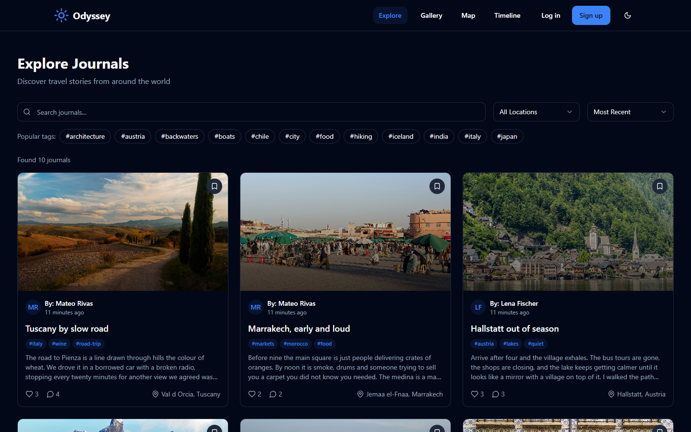
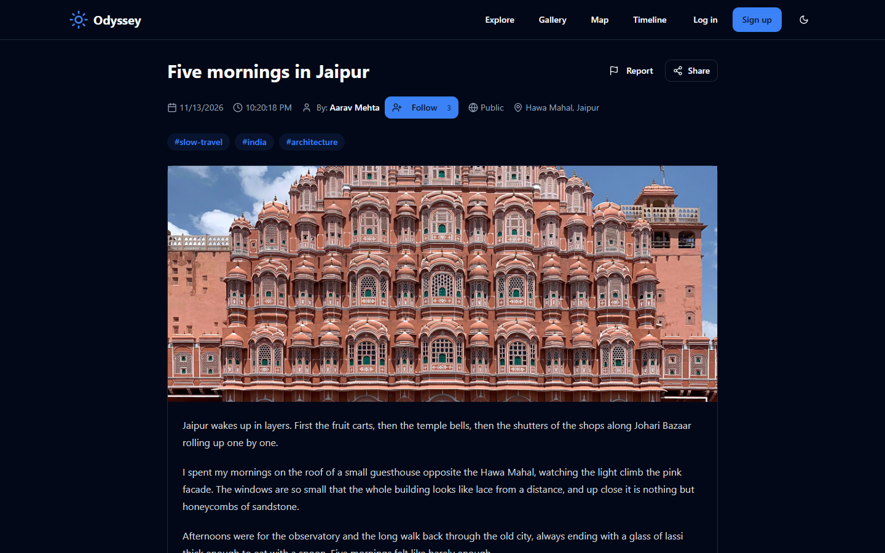
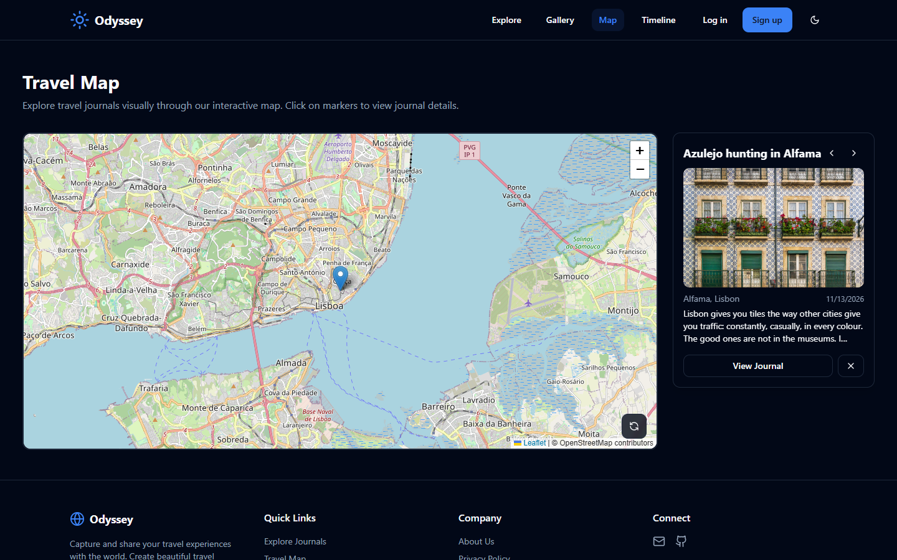
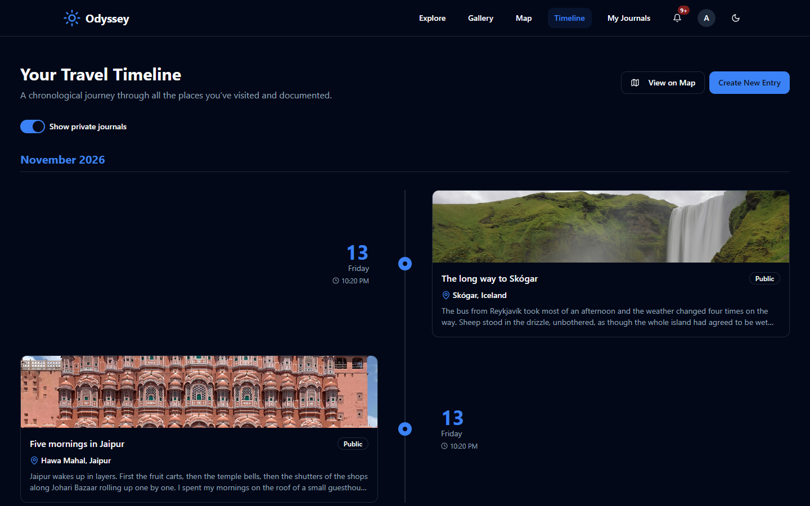
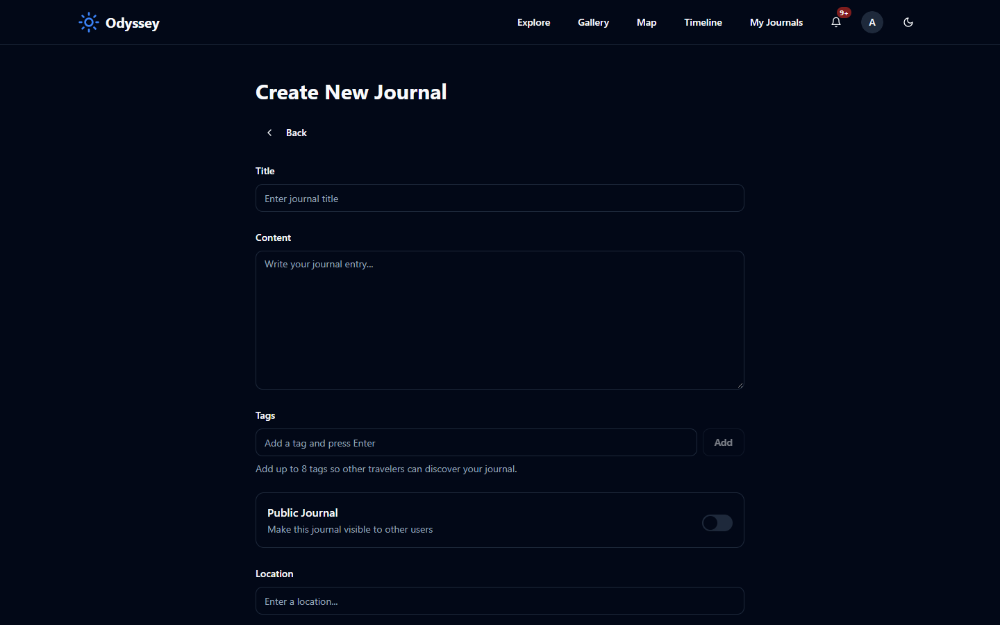
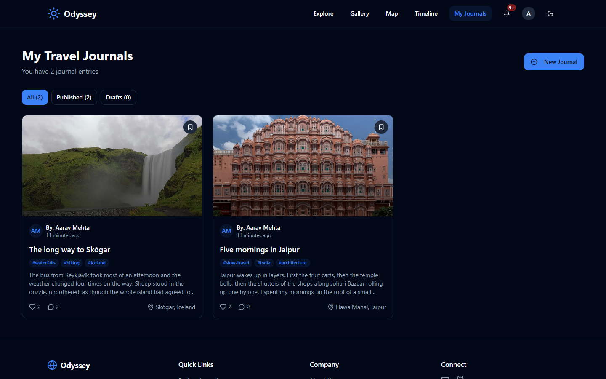
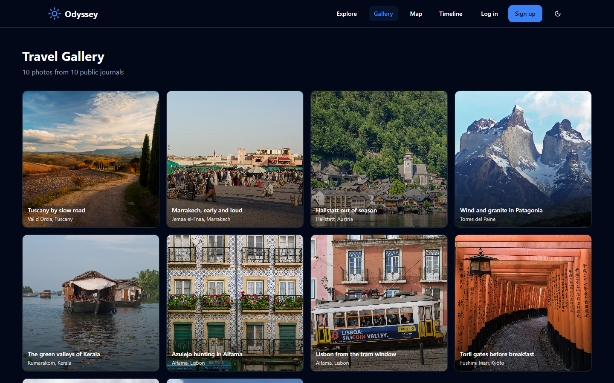
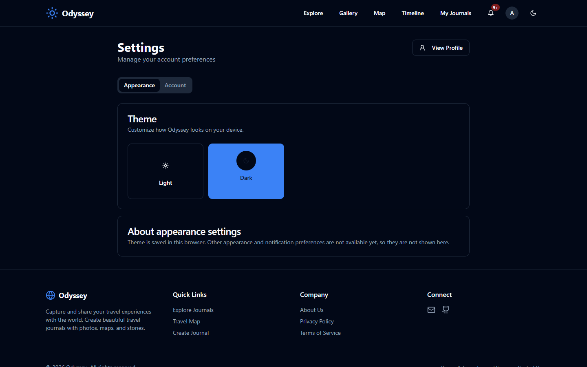
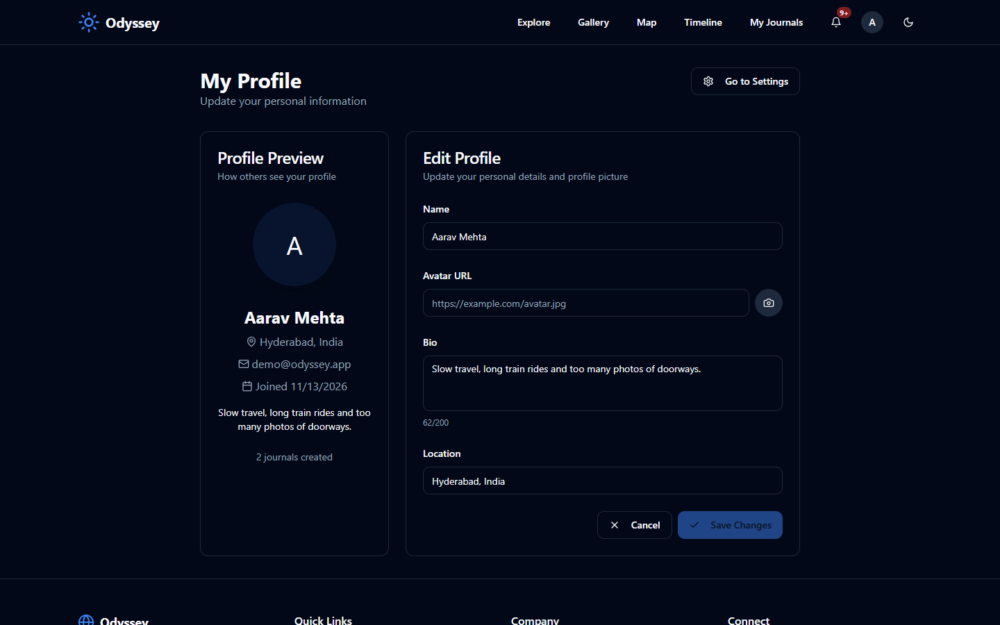

# Odyssey

[](https://github.com/vishnuendla/odyssey/actions/workflows/ci.yml)
[](./LICENSE)

A full-stack travel journaling platform for documenting, sharing and reliving trips. Write rich journal entries with photos and places, browse other travellers' public stories, and see every journey laid out on an interactive map and timeline.


## Features

- **Travel journals** — create, edit and delete entries with a title, story text, cover photos and a tagged location.
- **Tags and search** — add up to eight tags per journal, filter the public feed by tag, and search titles, stories and places from the server.
- **Photo galleries** — upload images per journal; files are stored by the backend and served through `/api/storage/files/...`. A public gallery collects photos from every public journal.
- **Bookmarks** — save any public journal and return to it from the Saved Journals page.
- **Public profiles** — every author has a public page listing their published journals, without exposing their email address.
- **Interactive maps** — Leaflet maps show journal locations, with automatic geocoding and autocomplete powered by Geoapify.
- **Timeline view** — see your trips ordered chronologically with locations and reaction/comment counts.
- **Explore** — a public feed of every public journal with server-side search, tag and location filters and recent/oldest/popular sorting.
- **Drafts and published views** — filter your own journals into drafts (private) and published entries.
- **Social interactions** — reactions and comments on journals, with author names and avatars. Comments support one level of threaded replies.
- **Following and notifications** — follow other travellers and get an in-app notification bell for new followers, reactions, comments, replies and saved journals.
- **Trust and safety** — report journals or comments, and resolve reports from an admin moderation queue that can hide content. Hidden entries disappear from public feeds while staying visible to their author and moderators.
- **Onboarding** — new accounts get a short checklist for completing their profile, writing a first journal and exploring the map.
- **Sharing** — shareable links for public journals, Open Graph previews for journal pages, and visibility control (public vs private) per entry.
- **Accounts** — email/password registration with server-side validation, email verification, password reset, and session management. Access tokens live in short-lived HttpOnly cookies; rotating refresh tokens can be reviewed and revoked from the Security page.
- **Operations** — Docker images for the API and web app, a Compose stack with MySQL, Actuator health probes, and backup/restore guides.
- **Dark mode and responsive layout** — usable from a phone to a desktop.
- **Accessible by default** — keyboard-operable journal cards and map markers, labelled pagination, lazy-loaded gallery images and a feed that loads authors and places without per-entry queries.

## Screenshots

| Explore public journals | Journal page |
| --- | --- |
|  |  |

| Interactive map | Timeline |
| --- | --- |
|  |  |

| Create a journal | Your journals |
| --- | --- |
|  |  |

| Photo gallery | Settings |
| --- | --- |
|  |  |

| Profile | Mobile |
| --- | --- |
|  |  |

## Tech stack

| Layer | Technology |
| --- | --- |
| Frontend | React 18, TypeScript, Vite, Tailwind CSS, shadcn/ui, React Router, Leaflet, TanStack Query |
| Backend | Java 17, Spring Boot 3.2, Spring Security (JWT), Spring Data JPA, Hibernate, Maven |
| Database | MySQL 8 |
| Geocoding | Geoapify autocomplete and geocoding APIs |
| CI | GitHub Actions (frontend lint/typecheck/test/build, backend Maven verify) |

## Getting started

### Requirements

- Node.js 20+ and npm
- Java 17+ and Maven
- MySQL 8 running locally

### 1. Backend

```powershell
Set-Location odyssey-backend
$env:DB_USERNAME = "root"
$env:DB_PASSWORD = "your-local-mysql-password"
$env:JWT_SECRET  = [Convert]::ToBase64String([Security.Cryptography.RandomNumberGenerator]::GetBytes(32))
# Optional: enables location autocomplete through the backend proxy.
$env:GEOAPIFY_API_KEY = "your-geoapify-key"
mvn spring-boot:run
```

The backend starts on <http://localhost:9090> and creates the `odyssey_db` database on first run (`createDatabaseIfNotExist=true`). Schema changes are applied by Flyway migrations in `src/main/resources/db/migration`, and Hibernate validates the schema rather than altering it.

Email is not required for local development: with the default `MAIL_MODE=log`, verification and password-reset links are printed to the backend console instead of being sent. Copy the link into your browser to complete the flow.

### 2. Frontend

```powershell
Set-Location odyssey-frontend
npm ci
npm run dev
```

Open <http://localhost:3000>. Vite proxies `/api` requests to the backend on port `9090`.

### Environment variables

| Variable | Where | Required | Purpose |
| --- | --- | --- | --- |
| `DB_URL` | backend | no | JDBC URL, defaults to `jdbc:mysql://localhost:3306/odyssey_db?...` |
| `DB_USERNAME` | backend | no | Database user, defaults to `root` |
| `DB_PASSWORD` | backend | yes | Database password |
| `JWT_SECRET` | backend | yes | HMAC key for signing tokens, at least 32 bytes |
| `JWT_ACCESS_EXPIRATION` | backend | no | Access-token lifetime in ms, defaults to 15 minutes |
| `JWT_REFRESH_EXPIRATION` | backend | no | Refresh-token lifetime in ms, defaults to 7 days |
| `JWT_REMEMBER_REFRESH_EXPIRATION` | backend | no | Refresh-token lifetime for "keep me signed in", defaults to 30 days |
| `JWT_ISSUER` / `JWT_AUDIENCE` | backend | no | Token `iss`/`aud` claims, default to `odyssey` / `odyssey-web` |
| `COOKIE_SECURE` | backend | no | Set to `true` to mark auth cookies `Secure` (required behind HTTPS) |
| `FILE_UPLOAD_DIR` | backend | no | Where uploaded images are stored, defaults to `uploads` |
| `MANAGEMENT_ENDPOINTS` | backend | no | Actuator endpoints to expose, defaults to `health,info,metrics` |
| `CORS_ALLOWED_ORIGINS` | backend | no | Comma-separated origins allowed to call the API, defaults to local Vite origins |
| `FRONTEND_URL` | backend | no | Base URL used in verification and reset email links, defaults to `http://localhost:3000` |
| `MAIL_MODE` | backend | no | `log` (default) prints email links to the console; `smtp` sends them |
| `MAIL_FROM` | backend | no | From address for transactional email |
| `MAIL_HOST` / `MAIL_PORT` | backend | no | SMTP host and port when `MAIL_MODE=smtp` |
| `MAIL_USERNAME` / `MAIL_PASSWORD` | backend | no | SMTP credentials when `MAIL_MODE=smtp` |
| `MAIL_SMTP_AUTH` / `MAIL_SMTP_STARTTLS` | backend | no | SMTP auth and STARTTLS toggles, default to `false` |
| `GEOAPIFY_API_KEY` | backend | no | Location autocomplete and geocoding; proxied through `/api/locations/**` |

The Geoapify key stays on the backend. The browser only calls the Odyssey API, so the key is never embedded in the JavaScript bundle. Uploads accept up to 5 images per request, 5 MB each and 15 MB total.

## API overview

All mutating requests need the `X-XSRF-TOKEN` header, echoing the `XSRF-TOKEN` cookie. The SPA bootstraps it from `GET /api/auth/csrf` and handles this automatically.

| Method | Path | Auth | Description |
| --- | --- | --- | --- |
| GET | `/api/auth/csrf` | public | Issue a CSRF token cookie |
| POST | `/api/auth/register` | public | Create an account and start a session |
| POST | `/api/auth/login` | public | Sign in (optional `rememberMe`) |
| POST | `/api/auth/refresh` | public | Rotate the refresh cookie and issue a new access token |
| POST | `/api/auth/logout` | public | End the current session |
| POST | `/api/auth/logout-all` | user | End every session for the account |
| GET | `/api/auth/me` | user | Current profile (includes `emailVerified`) |
| GET | `/api/auth/users/{id}` | public | Public author card (never includes email) |
| GET | `/api/auth/users/{id}/journals` | public | Public journals by an author |
| PUT | `/api/auth/profile` | user | Update name, avatar, bio or location |
| GET | `/api/auth/sessions` | user | Active sessions with device and IP hints |
| DELETE | `/api/auth/sessions/{id}` | user | Revoke one session |
| POST | `/api/auth/change-password` | user | Change password and sign out other devices |
| POST | `/api/auth/forgot-password` | public | Send a reset link (enumeration-safe response) |
| POST | `/api/auth/reset-password` | public | Consume a reset token and set a new password |
| POST | `/api/auth/verify-email` | public | Consume an email verification token |
| POST | `/api/auth/resend-verification` | user | Resend the verification email |
| DELETE | `/api/auth/account` | user | Permanently delete the account and its data |
| GET | `/api/journals` | user | Public journals plus the caller's own entries; admins see everything |
| GET | `/api/journals/public?page=&size=` | public | Paged public journals |
| GET | `/api/journals/search?q=&tag=&location=&sort=&page=&size=` | public | Search public journals by text, tag and place |
| GET | `/api/journals/tags` | public | Tags used by public journals |
| GET | `/api/journals/bookmarks` | user | Journals saved by the caller |
| GET | `/api/journals/my` | user | Journals owned by the caller |
| GET | `/api/journals/{id}` | public | Single journal (private entries visible to the owner only) |
| POST | `/api/journals` | verified user | Create a journal |
| PUT | `/api/journals/{id}` | verified user | Update a journal |
| DELETE | `/api/journals/{id}` | user | Delete a journal |
| POST | `/api/journals/{id}/bookmark` | user | Save a public journal |
| DELETE | `/api/journals/{id}/bookmark` | user | Remove a saved journal |
| GET | `/api/journals/{id}/reactions` | user | Reaction summary |
| POST | `/api/journals/{id}/comments` | verified user | Add a comment or a reply (`parentId`) |
| DELETE | `/api/journals/{id}/comments/{commentId}` | user | Delete a comment and its replies (author, journal owner or admin) |
| POST | `/api/users/{id}/follow` | user | Follow a traveller |
| DELETE | `/api/users/{id}/follow` | user | Unfollow a traveller |
| GET | `/api/users/{id}/followers` | public | Followers of a traveller |
| GET | `/api/users/{id}/following` | public | Accounts a traveller follows |
| GET | `/api/notifications` | user | Activity for the caller |
| GET | `/api/notifications/unread-count` | user | Unread badge count |
| POST | `/api/notifications/{id}/read` | user | Mark one notification read |
| POST | `/api/notifications/read-all` | user | Mark every notification read |
| DELETE | `/api/notifications/{id}` | user | Delete a notification |
| POST | `/api/reports` | user | Report a journal or comment |
| GET | `/api/admin/reports?status=` | admin | Moderation queue |
| PATCH | `/api/admin/reports/{id}` | admin | Resolve with `HIDE` or `DISMISS` |
| PATCH | `/api/admin/journals/{id}/visibility?hidden=` | admin | Hide or restore a journal |
| PATCH | `/api/admin/comments/{id}/visibility?hidden=` | admin | Hide or restore a comment |
| GET | `/api/admin/stats` | admin | User, journal, comment and report counts |
| POST | `/api/storage/upload` | user | Upload journal images |
| GET | `/api/storage/files/{file}` | public | Serve an uploaded image |
| GET | `/api/locations/search?q=` | user | Location search |
| GET | `/actuator/health` | public | Liveness and readiness probe |
| GET | `/actuator/metrics` | admin | JVM and HTTP metrics |

Unverified accounts can browse and edit their profile, but publishing journals and commenting stay locked until the email address is confirmed.

## Project structure

```text
odyssey/
├── odyssey-backend/          Spring Boot API
│   ├── src/main/java/com/odyssey/
│   │   ├── config/           Security, CORS, JWT, cache and actuator configuration
│   │   ├── controller/       REST endpoints
│   │   ├── dto/              Request/response models with validation rules
│   │   ├── entity/           JPA entities
│   │   ├── exception/        Error envelope and exception handlers
│   │   ├── repository/       Spring Data repositories
│   │   ├── security/         JWT auth, CSRF and password hashing
│   │   └── service/          Business logic, mail, rate limiting and audits
│   ├── src/main/resources/db/migration/  Flyway schema migrations (V1–V6)
│   ├── src/test/             Auth, social and query-count integration tests (H2)
│   ├── Dockerfile            Multi-stage JDK 17 build
│   └── uploads/              Uploaded journal images
├── odyssey-frontend/         React application
│   ├── src/
│   │   ├── components/       UI, layout and feature components
│   │   ├── contexts/         Auth and journal state
│   │   ├── pages/            Route-level screens
│   │   ├── services/         API client and its unit tests
│   │   ├── test/             Vitest setup
│   │   └── utils/            Geocoding and helpers
│   ├── Dockerfile            Vite build served by nginx
│   └── nginx.conf            SPA fallback and `/api` proxy
├── docs/
│   ├── DEPLOYMENT.md         Docker deployment guide
│   ├── BACKUP_RESTORE.md     Database and uploads backup runbook
│   └── screenshots/          README screenshots
├── docker-compose.yml        MySQL, backend and frontend stack
├── .env.example              Deployment environment template
└── .github/workflows/ci.yml  CI pipeline
```

## Checks and CI

GitHub Actions runs on every push and pull request to `dev` and `main`:

```powershell
Set-Location odyssey-frontend
npm ci
npm run lint
npm run typecheck
npm run test
npm run build

Set-Location ../odyssey-backend
mvn --batch-mode --no-transfer-progress verify
```

The backend suite covers registration, validation envelopes, CSRF enforcement, refresh-token rotation and reuse detection, verification gating, password changes, account deletion, bookmarks, tag/search filtering, public profiles, follows and notifications, threaded comments and report-driven moderation (`AuthFlowIntegrationTest`, `Phase3SocialIntegrationTest`). `JournalQueryCountTest` guards the feed against per-journal N+1 queries. The frontend uses Vitest and Testing Library for the API client (error envelopes, CSRF headers, refresh-and-retry) and route-level accessibility regressions.

## Deployment

Docker files, a Compose stack, production configuration, and backup/restore
runbooks live in the repository:

```bash
cp .env.example .env   # set MYSQL_ROOT_PASSWORD, MYSQL_APP_PASSWORD and JWT_SECRET
docker compose up -d --build
```

Then open <http://localhost:8080>. Full instructions, TLS notes, admin promotion
and upgrade steps are in [`docs/DEPLOYMENT.md`](docs/DEPLOYMENT.md).
Backups are covered in [`docs/BACKUP_RESTORE.md`](docs/BACKUP_RESTORE.md).

To promote a moderator after signing up:

```sql
UPDATE users SET role = 'ADMIN' WHERE email = 'you@example.com';
```

## Troubleshooting

- **`invalid flag: --release`** while building the backend — Maven is running on JDK 8. Point `JAVA_HOME` at a JDK 17+ installation.
- **`Access denied for user 'root'@'localhost'`** — set `DB_PASSWORD` to your local MySQL password before starting the backend.
- **`Schema-validation: wrong column type`** on startup — the database was created by an older build. Delete the `odyssey_db` schema (or run the migrations by hand) and start the backend again.
- **No verification or reset email arrives** — this is expected in local development. With `MAIL_MODE=log` the link is printed in the backend console; copy it into the browser.
- **`403` for a form submission** — the CSRF cookie is missing or blocked. Allow cookies for the site and reload the page.
- **A journal card shows the placeholder graphic** — that entry has no photo, or its uploaded file is missing from `odyssey-backend/uploads/`. Missing images fall back to `public/placeholder.svg` instead of a broken-image icon.
- **Location search returns nothing** — set `GEOAPIFY_API_KEY` for the backend and restart it; the key is no longer a `VITE_*` variable.
- **`401`/`403` on private pages after changing `JWT_SECRET`** — old cookies are invalid, sign in again.

## License

Odyssey is free software: you can redistribute it and/or modify it under the terms of the GNU General Public License v3.0 as published by the Free Software Foundation.

- Full license text: see [`LICENSE`](./LICENSE)
- Copyright (C) 2026 vishnuendla
- Learn more: <https://www.gnu.org/licenses/gpl-3.0.html>
